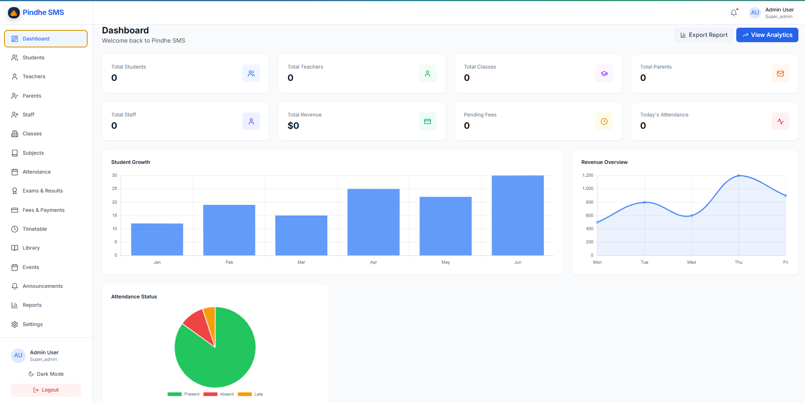

# Pindhe SMS - School Management System

<p align="center">
  
</p>
A complete, modern, responsive, and professional School Management System built with React.js (Vite), Tailwind CSS, Node.js, Express.js, and MongoDB.

## 🚀 Features

- **Authentication**: Login, logout, forgot password, role-based access control
- **Dashboard**: Statistics, charts, recent activities
- **Student Management**: CRUD, search, filter, sort, pagination, CSV export
- **Teacher Management**: CRUD, class/subject assignment, salary
- **Parent Management**: CRUD, link to children
- **Staff Management**: CRUD, department, job title, salary
- **Class Management**: Grade 1-12, sections, capacity
- **Subject Management**: CRUD, subject codes
- **Attendance**: Student attendance tracking, stats, export
- **Teacher Attendance**: Track teacher attendance
- **Examinations**: Create exams, enter marks, auto grade calculation
- **Fees & Payments**: Fee categories, payments, receipts
- **Timetable**: Weekly timetable with conflict prevention
- **Library**: Book management, borrow/return
- **Events**: School events calendar
- **Announcements**: Targeted announcements
- **Reports**: Multiple report types with export

## 📁 Project Structure

```
pindhe-sms/
├── client/                 # Frontend (React + Vite + Tailwind)
├── server/                 # Backend (Node.js + Express + MongoDB)
└── README.md
```

## 🛠️ Prerequisites

- **Node.js** (v16 or higher)

## 📦 Installation

### 1. Navigate to Project

```bash
cd c:\Users\ACER\Desktop\nour
```

### 2. Install Backend Dependencies

```bash
cd server
npm install
```

### 3. Install Frontend Dependencies

```bash
cd ../client
npm install
```

### 4. Configure Environment Variables


### 5. Start MongoDB

Make sure MongoDB is running on your system:

**Windows:**
```bash
net start MongoDB
```
Or run `mongod` if installed manually.

**macOS:**
```bash
brew services start mongodb-community
```


## 🏃‍♂️ Running the Application

### Start the Backend Server

```bash
cd server
npm run dev
```
Server will run on `http://localhost:5001`

### Start the Frontend Development Server

```bash
cd client

## 🔐 Demo Credentials

| Role | Email | Password |
|------|-------|----------|
| Super Admin | admin@pindhe-sms.com | admin123 |
| Teacher | teacher@pindhe-sms.com | teacher123 |
| Parent | parent@pindhe-sms.com | parent123 |
| Student | student@pindhe-sms.com | student123 |

## 📊 API Endpoints

### Authentication
- `POST /api/auth/register` - Register new user
- `POST /api/auth/login` - Login
- `POST /api/auth/logout` - Logout
- `GET /api/auth/me` - Get current user
- `POST /api/auth/forgotpassword` - Forgot password
- `PUT /api/auth/updatepassword` - Update password
- `PUT /api/auth/updateprofile` - Update profile

### Students
- `GET /api/students` - List students
- `POST /api/students` - Create student
- `GET /api/students/:id` - Get student
- `PUT /api/students/:id` - Update student
- `DELETE /api/students/:id` - Delete student
- `GET /api/students/export/csv` - Export to CSV

### Teachers, Parents, Staff, Classes, Subjects

### Attendance
- `GET /api/attendance` - List attendance
- `POST /api/attendance/mark` - Mark attendance
- `GET /api/attendance/stats` - Attendance statistics

### Examinations & Results
- `GET /api/examinations` - List exams
- `POST /api/examinations` - Create exam
- `GET /api/exam-results` - List results
- `POST /api/exam-results` - Create result
- `PUT /api/exam-results/calculate-grades` - Calculate grades

### Fees & Payments
- `GET /api/fees` - List fees

## 🎨 UI/UX Features

- Responsive Design: Desktop, tablet, mobile
- Dark/Light Mode: Toggle between themes
- Sidebar Navigation: Collapsible with role-based menu
- Top Navigation: Search, notifications, profile dropdown
- Toast Notifications: Success/error feedback
- Modal Dialogs: Create/edit forms
- Loading States: Visual feedback during data fetching
- Empty States: Graceful handling of no data
- Charts: Chart.js integration
- Icons: Lucide React icons
- Print Support: Print pages for reports

## 🔧 Technology Stack

**Frontend**: React 18, Vite, Tailwind CSS, React Router DOM, Chart.js, Lucide React, Axios, React Hot Toast

**Backend**: Node.js, Express.js, MongoDB (Mongoose), JWT, bcryptjs

**Validation**: Express Validator

**File Upload**: Multer

## 🔒 Security Features

- JWT authentication with HTTP-only cookies
- Password hashing with bcrypt
- Role-based access control (RBAC)
- Protected routes
- Input validation with express-validator
- CORS configuration
- Rate limiting
- Helmet security headers

## 📱 Mobile Support

Fully responsive on:
- Desktop (1200px+)
- Tablet (768px - 1199px)
- Mobile (320px - 767px)

## 🤝 Contributing

1. Fork the repository
2. Create a feature branch
3. Make your changes
4. Submit a pull request

## 📄 License

MIT License

## 📞 Support

For support, please contact the system administrator or create an issue in the repository.

---

**Pindhe SMS** - School Management System v1.0.0

**Email**: Nodemailer

**PDF/CSV**: pdfkit, json2csv

## 📝 Grade System

| Grade | Range |
|-------|-------|
| A | 90-100 |
| B | 80-89 |
| C | 70-79 |
| D | 60-69 |
| E | 50-59 |
| F | Below 50 |
- `POST /api/fees` - Create fee
- `GET /api/payments` - List payments
- `POST /api/payments` - Create payment

### Timetables, Events, Library, Announcements, Expenses, Settings

Full CRUD operations for each resource.

Full CRUD operations for each resource with similar endpoint patterns:
- `GET /api/{resource}` - List
- `POST /api/{resource}` - Create
- `GET /api/{resource}/:id` - Get by ID
- `PUT /api/{resource}/:id` - Update
- `DELETE /api/{resource}/:id` - Delete

Resources: teachers, parents, staff, classes, sections, subjects
npm run dev
```
Frontend will run on `http://localhost:5173`

### Access the Application

Open your browser and navigate to: `http://localhost:5173`
**Linux:**
```bash
sudo systemctl start mongod
```
Edit `server/.env`:

```env
PORT=5001
NODE_ENV=development
MONGODB_URI=mongodb://localhost:27017/pindhe_sms
JWT_SECRET=pindhe_sms_secret_key_2024
JWT_EXPIRE=30d
CLIENT_URL=http://localhost:5173
SMTP_HOST=smtp.ethereal.email
SMTP_PORT=587
SMTP_USER=
SMTP_PASS=
SMTP_FROM=noreply@pindhe-sms.com
```
- **MongoDB** (v4.4 or higher)
- **MongoDB Compass** (optional, for GUI database management)
- **npm** or **yarn**
- **Settings**: School config, dark mode, language
- **UI/UX**: Light/dark mode, responsive, Lucide icons, toast notifications# Pindhe-SMS
